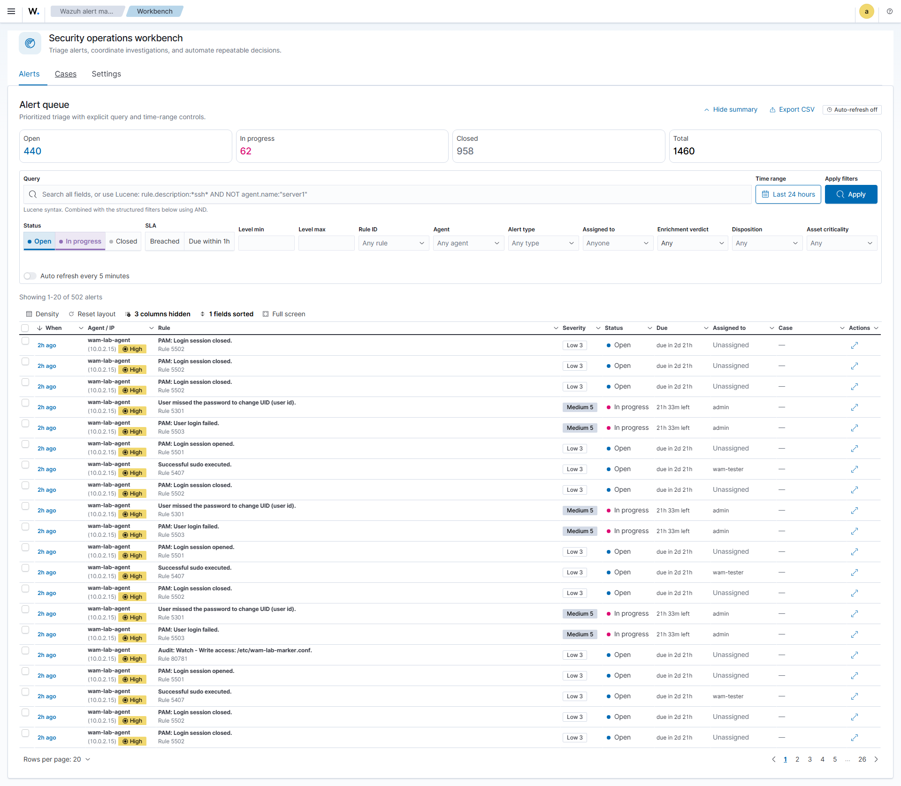

# Wazuh Alert Manager

**Wazuh Alert Manager** is an (unofficial) OpenSearch Dashboards plugin that turns Wazuh alerts into a working SOC workbench: triage alerts with a real lifecycle, group them into investigative cases, automate the routine handling, and report on what your team is doing.

This wiki documents the **3.0 line** (currently the pre-release
**v3.0.0-rc.1**). **v2.0.3 remains the latest stable release**; its notes stay
at [[Release Notes 2.0.2|Release-Notes-2.0]].

> ⚠️ **Unofficial** — this plugin is not produced or endorsed by Wazuh Inc. It reads Wazuh's alerts (4.x `wazuh-alerts-*`) or findings (5.0 `wazuh-findings-v5-*`) and stores its own workflow state in separate indices; it never modifies native Wazuh storage.

## What it gives you

- **Alert lifecycle** — every alert carries an **Open → In progress → Closed** status, an assignee, and an audit history, stored independently of the raw Wazuh alert.
- **Cases** — bundle related alerts into an investigation with severity, status, comments, an **attack-path graph**, and MITRE **kill-chain** view.
- **Automation rules** — match alerts and, on a per-alert or burst trigger, **open a case** (optionally applying a task list), **auto-close** routine noise with a disposition, **auto-assign** to an analyst, and/or **notify** a channel. See [[Automation Rules]].
- **Case structure** — tasks and reusable **task lists**, a merged timeline, attachments, and dispositions on close.
- **SLA enforcement** — editable per-band assign/resolve targets, due dates and Breached badges on both queues, and a scanner that escalates (assign, raise severity, comment, notify). See [[Reporting]].
- **Enrichment and asset context** — threat-intelligence lookups (AbuseIPDB, MISP, generic HTTP, and on Wazuh 5.0 the local CTI catalog) over the indicators extracted from every record, plus asset criticality rules and OS / ports / vulnerability / SCA chips read from `wazuh-states-*`.
- **Notifications** — deliver through your existing Wazuh Notifications channels (Slack, Teams, email, SNS, webhook) or a direct HMAC-signed webhook, behind a durable outbox. See [[Notifications]].
- **Exports** — CSV for both queues, a per-case Markdown/HTML report, a Reporting export menu (HTML, Markdown, CSV, JSON, Print / Save as PDF), and scheduled Markdown summaries.
- **Triage helpers** — a **"seen before"** precedent callout and **suggested related alerts**, both deterministic (no LLM).
- **Reporting** — status donuts, status-over-time, period-over-period deltas, SLA compliance, and per-analyst workload/performance. See [[Reporting]].
- **Bounded storage lifecycle** — roll alert, activity, case, and evidence generations; retire, restore, reopen, or explicitly purge them under administrator control. See [[Lifecycle, Retention and RBAC|Lifecycle-Retention-and-RBAC]].
- **Optional AI analysis** — bring-your-own-key summaries with a strict egress boundary. See [[AI Analysis]] and [[Security Model]].

## Supported versions

| Wazuh release(s) | OpenSearch Dashboards | Plugin build |
|------------------|-----------------------|--------------|
| 4.12.0 | 2.19.1 | `wazuhAlertManager-2.19.1.zip` |
| 4.13.0–4.13.1 | 2.19.2 | `wazuhAlertManager-2.19.2.zip` |
| 4.14.0–4.14.1 | 2.19.3 | `wazuhAlertManager-2.19.3.zip` |
| 4.14.2–4.14.4 | 2.19.4 | `wazuhAlertManager-2.19.4.zip` |
| 4.14.5–4.14.7 | 2.19.5 | `wazuhAlertManager-2.19.5.zip` |
| 4.14.8–4.14.10 | 2.19.6 | `wazuhAlertManager-2.19.6.zip` |
| 5.0.0-rc2 (**preview**) | 3.6.0 | `wazuhAlertManager-3.6.0.zip` |

Download the zip matching the exact dashboard version from the **[Releases page](https://github.com/xrisbarney/Wazuh-alert-manager/releases)**. The source code is identical across builds, but each ZIP is compiled and stamped for one exact OSD version and one Wazuh line: 4.x builds read `wazuh-alerts-*`, the 5.0 build reads the `wazuh-findings-v5-*` data streams. See [[Architecture#one-plugin-for-wazuh-4x-and-50]].

## Where to next

- **[[Installation]]** — install/upgrade the plugin.
- **[[User Guide]]** — the Workbench (Alerts, Cases, Settings) and Reporting.
- **[[Automation Rules]]** — the rule engine in depth.
- **[[Lifecycle, Retention and RBAC|Lifecycle-Retention-and-RBAC]]** — rollover, retirement, restore, retention, and administrator permissions.
- **[[Case Evidence and Case Lifecycle|Case-Evidence-and-Case-Lifecycle]]** — what remains live, what is archived, and how a case is reopened safely.
- **[[Security Model]]** — identity, data egress, and what leaves the network.
- **[[Troubleshooting]]** — common issues (including the indexer startup timeout).
- **[[Architecture]]** — how the sync job and indices work.
- **[[Release Notes 2.0.2|Release-Notes-2.0]]** — shipped features, compatibility, and validation evidence.
