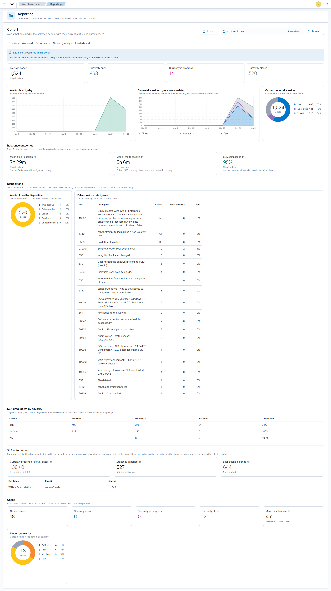

# Reporting

The **Reporting** app (second entry in the nav group) summarises alert and case activity over a time range you choose with the date picker. It has an **Overview** tab plus per-analyst tabs.

## Overview

- **KPI tiles** — Total alerts, Open / In progress / Closed, Mean time to assign, Mean time to resolve, and SLA compliance. Time-based tiles carry an info tooltip explaining exactly how they're measured.
- **Period-over-period deltas** — each KPI shows a **▲/▼ %** vs the immediately preceding equal-length window. Colour encodes *better/worse*, not just direction (a rising resolve time is red; a rising SLA % is green). Hover for the prior value.
- **Alert volume per day** — an area trend.
- **Current disposition by occurrence date** — a **stacked** daily chart showing the current status of alerts that occurred on each date. It is not historical status as of that date.
- **Alerts by status** and **Cases by severity** — donut charts with a count-legend (dot · label · count · %) and a centre total.
- **SLA breakdown by severity** — resolved / within-SLA / breached / compliance %, against the severity-based targets.
- **Cases** — created count, status split, and mean time to close.

### Accuracy notes

- **All operational figures are exact for the live, unarchived cohort** — total alerts, status breakdown, MTTA, MTTR, SLA, per-analyst resolution, and leaderboard. There is no sampling.
- **Timing and SLA come from bounded write-time fields** materialized when an alert is assigned or closed (`reporting.*` on the alert projection). Alert and case totals, timing, status, and severity are exact OpenSearch aggregations; per-analyst buckets use complete composite pagination instead of a top-N or document sample. A resumable background backfill materializes alert timing fields for records that predate the release; until it completes, the Overview shows a "backfill pending" notice rather than a silent sample.
- Reports query live, unarchived alert and case aliases. Archived alerts and cases are excluded. Restoring alerts can therefore change totals and timing or SLA results for historical time ranges.
- Timing depends on live activity history. If activity has been retired or the write-time fields are pending backfill, timing and SLA results can be incomplete and the UI marks it explicitly.
- Reports are current operational views, not immutable compliance records. When a fixed audit record is required, use the **Export** menu in the Reporting header (HTML, Markdown, CSV, JSON, or Print / Save as PDF; served by `GET /reports/export` over exactly the cohort the page shows) to preserve a snapshot — see the [[User-Guide#export|User Guide » Export]] paragraph.

## SLA targets

The targets are editable by a plugin administrator under **Settings > SLA** (stored in the plugin's meta index as the `sla_policy` document; `GET /sla/policy` is readable by every signed-in user, `PUT /sla/policy` is administrator-only and audited as `sla_policy_updated`). These are the built-in defaults, in effect until someone saves a policy:

| Severity | Wazuh level | Assign within | Resolve within |
|----------|-------------|---------------|----------------|
| Critical | 12+ | 15 minutes | 1 hour |
| High | 7–11 | 1 hour | 4 hours |
| Medium | 4–6 | 6 hours | 24 hours |
| Low | 0–3 | 18 hours | 3 days |

On a Wazuh 5.0 build the severity labels map onto the same bands directly (informational counts as Low). A changed target applies to alerts closed from then on and to the targets the Overview cites; alerts closed earlier keep the SLA verdict recorded at close time. Each dashboard replica caches the policy for up to 60 seconds.

SLA compliance is the share of *resolved* alerts closed within their severity's target, subject to the live-data and activity-history scope above.

### Due timestamps

Every alert gets two due timestamps when it is first projected into the queue: `reporting.sla_due_at` (`@timestamp` plus the resolve target of its severity band) and `reporting.assign_due_at` (`@timestamp` plus the assign target). Both adapters stamp them through the same band model, so a Wazuh 5.0 label-only finding gets the same targets as the equivalent 4.x level; a record with neither a level nor a recognised label has no due date. Cases get `sla_due_at` = `created_at` plus the resolve target of the case severity, recomputed when the severity is changed. A sync replay never moves a due date. Saving a policy whose targets changed schedules a backfill (`sla_due_backfill` in the meta index; `GET /sla/backfill` shows its progress and `POST /sla/backfill` lets an administrator start it again, answering 202 while it runs) that recomputes both alert fields for every open and in-progress alert as a throttled server-side task; alerts edited while it runs are re-run in up to three passes, and a run that still reports `partial` or `failed` can simply be started again. Closed alerts keep the due date they had, just as they keep their SLA verdict. The queues show a **Due** column (sortable; "Breached" and "Due soon" badges, the latter within 60 minutes of the due date) with the **Breached** and **Due within 1h** quick filters, the alert and case flyouts show the same countdown, and the CSV exports carry the raw timestamps.

### SLA escalation

A background scanner (one dashboard replica at a time, through the `sla_escalation` lease; `wazuh_alert_manager.sla.escalation.enabled`, default on, `tickSeconds`, default 60, range 15–3600, and `breachNotifyGraceMinutes`, default 1440: a record overdue for longer than that is stamped but sends no `sla.breached` notification, see [Notifications](Notifications)) runs two passes every tick:

- **Breach.** Every open or in-progress alert whose `reporting.sla_due_at` has passed, and every non-closed case whose `sla_due_at` has passed (a case created before the due-date fields existed, with no `sla_due_at`, counts once `created_at` plus its severity's resolve target has passed), gets one `sla_breached` activity event and then a `sla.breached_at` stamp exactly once with an **SLA breached** row in its history. The event is written before the stamp, so an interrupted tick can leave an event the next tick completes, never a stamped record without its event. The stamp never touches `updated_at` or the assignee. At most 5,000 alerts and 5,000 cases are stamped per tick; the rest follow on the next tick.
- **Escalation.** The **Escalations** editor under **Settings > SLA** holds up to 20 rules, each with a target (alerts or cases), a threshold (percentage of the severity band's resolve target that has elapsed), a condition and one or more actions. The threshold is evaluated per band from the current policy: a record is a candidate once its start time (`@timestamp` for alerts, `created_at` for cases) is older than `resolve target × threshold / 100`, which also means a changed target applies immediately, before the due-date backfill has run. Conditions: **any**; **unassigned** (no assignee); **untouched** (unassigned, still `open`, never assigned before and no history entry by anyone other than the scanner itself — a breach stamp or an earlier escalation does not count as a touch). Actions run in this order and go through the same history and reporting write shape the routes use, under the actor `system:sla`: **assign to** (sets the assignee and moves an open record to in progress, recording the first assignment for the SLA metrics), **raise severity** (cases only; one band up, capped at critical, with the due date recomputed from `created_at`), **comment** (a comment on the record; `{{id}}`, `{{severity}}`, `{{due_at}}` and `{{escalation}}` are substituted) and **notify** (the `sla.escalated` notification of this rule goes to these channel ids of **Settings > Notifications** instead of the channels bound to the event; the ids are also recorded on the `sla_escalated` activity event; see [Notifications](Notifications)). Each rule is applied at most once per record (`sla.escalated[]` marker, written after the `sla_escalated` activity event so an interrupted tick is completed next time without a second event), the flyouts show **Escalated: <rule names>** and the history shows an **applied an SLA escalation** row; the matching `sla_escalated` activity event carries the rule and the actions applied. Every write re-checks the record at write time (closed, already escalated, assigned meanwhile for an unassigned/untouched rule, assignee or severity already set), so two rules in one tick or two dashboards never append duplicate history rows. At most 500 records are escalated per tick (logged; the remainder follows next tick), and the scanner renews its lease as it goes, stopping when another dashboard has taken it.

Wazuh 5.0 label-only findings go through the same band model, so a `high` label is escalated with the High target exactly like a 4.x level 7–11 alert. `GET /sla/escalation/status` (any signed-in user) answers the last tick of the lease holder (`last_tick_at`, `breached_alerts`, `breached_cases`, `escalated`, the last ten `errors`, `capped`) with this replica's `enabled` (`null` when the scanner was never started on it) and `tickSeconds`; the Settings > SLA tab shows the same line under the editor. The stored errors name the error type and HTTP status only (the full OpenSearch message, aggregated per pass, is in the dashboard log), and the lease `holder` (hostname and pid) is returned only to plugin administrators.

### Currently breached and escalations in period

The Overview tab of **Reports** ends its SLA block with an **SLA enforcement** section, and the scheduled Markdown summary carries the same figures under `### SLA enforcement` (both come from `GET /reports/metrics`, so the page and a summary never disagree):

- **Currently breached (alerts / cases)** is a live count taken when the report is loaded, *not* bound to the selected period: open or in-progress alerts and open cases that carry the scanner's `sla.breached_at` stamp or whose resolve due date (`reporting.sla_due_at` for alerts, `sla_due_at` for cases) is already in the past, even if the scanner has not ticked yet. A case created before the due-date stamp existed (no `sla_due_at`) counts once its creation time plus its band's resolve target has passed, exactly as the scanner's breach pass treats it. If the activity index or a status index is missing, the figures read as zero rather than failing the page. The line under the tile splits it by severity band (alerts and cases added together, through the same band model the scanner uses).
- **Breaches in period** counts the `sla_breached` activity events whose time falls in the selected period (one per alert or case, when its due date first passed), split into alerts and cases.
- **Escalations in period** counts the `sla_escalated` activity events in the period, with a table of the rules applied (rule name and id as recorded on the event, so a renamed or deleted rule keeps the name it had when it fired). When the policy has no escalation rules the table is replaced by a hint to add them under **Settings > SLA**; when rules exist but none fired, it says so.

All of these are exact aggregations with explicit bounds (at most 50 escalation rules are listed; the policy holds 20) and read the activity index, so they also cover records that have been archived since. Only the live activity generations are searched: events in retired activity generations or older than `lifecycle.activityRetentionDays` are not counted, so a period reaching past the retention window undercounts breaches and escalations. Payloads are `slaCurrentlyBreached { asOf, alerts, cases, byBand }`, `slaBreachesInPeriod { total, alerts, cases }` and `slaEscalationsInPeriod { total, byEscalation[{ id, name, count }] }` on the metrics response.
## Dispositions

The Overview tab shows a **Dispositions** block between the response outcomes and the SLA breakdown, and the scheduled Markdown summary carries the same figures under `## Dispositions` (both come from `GET /reports/metrics`):

- **Alerts closed by disposition** is a donut of the alerts closed *in the selected period* by the outcome recorded at close time (see the User Guide's "Dispositions"). "Closed in the period" means `status: closed` with the write-time close stamp (`reporting.closed_at`) inside the range, so it follows the close time rather than the alert's occurrence time and a reopened alert drops out. An alert closed without a disposition (before this feature, or through an API client that sent none) counts as **Undetermined**.
- **False-positive rate by rule** lists, for the same closed alerts, the top 25 rules by closed count with their false-positive share (`false_positive / closed`). It is an exact aggregation inside each listed rule; rules beyond the 25 most closed are not listed.

Payloads are `dispositions { true_positive, false_positive, benign, duplicate, undetermined }` and `falsePositiveByRule[{ rule_id, description, closed, false_positive, rate }]` on the metrics response. A false-positive rate that stays high for a rule is the signal to tune or silence the rule; this plugin does not silence detections itself.

## Per-analyst tabs

- **Workload** — open / in-progress / closed / total per assignee (complete cardinality via composite aggregation).
- **Performance** — resolved count and mean time to resolve per assignee (exact, from write-time fields).
- **Cases by analyst** — case status split and mean time to close per owner (includes an In-progress column).
- **Leaderboard** — analysts ranked by resolved throughput (exact).

## Getting data out

Four paths, all read-only and all running as the signed-in user, so an export
never shows more than the page would:

| What | Where | Formats |
|---|---|---|
| The current alert or case queue | **Export CSV** in the queue toolbar | CSV, streamed with `search_after`, up to 10,000 rows (`x-wam-truncated: true` beyond that) |
| One case in full | **Report** in the case flyout header | Markdown, self-contained HTML, Print / Save as PDF |
| This Reporting page's window | **Export** in the Reporting header | HTML, Markdown, CSV (UTF-8 with BOM), JSON, Print / Save as PDF |
| A recurring summary | **Settings > Reports** | Markdown, delivered to channels and downloadable |

Every non-numeric CSV cell whose text begins with `=`, `+`, `-`, `@`, a tab or
a carriage return is prefixed with a single apostrophe and then quoted, so a
spreadsheet renders the exported value as text instead of executing it. The
apostrophe is the control; quoting alone would not neutralise a formula. HTML exports are
served with `X-Content-Type-Options: nosniff` and a per-response Content
Security Policy, and carry no script except the one that calls the browser's
Print dialog on the print view.

## Scheduled summaries

**Settings > Reports** holds up to 20 schedules. Each has a name, a cadence
(**daily** or **weekly** with a day of the week), an hour, a range in days (up
to 90) and the notification channels to deliver to.

- Slots are computed **in UTC only** — there is no local time zone and no DST
  handling. A schedule set to hour 6 renders at 06:00 UTC.
- A lease-based scheduler on one dashboard replica renders each slot **once**,
  however many replicas or ticks see it, and stores the Markdown as the meta
  document `report_run:<id>` (capped at 256 KiB). A missed slot is rendered at
  the next tick; older missed slots are **not** back-filled.
- A failed render never overwrites the last good report: the error, failed slot
  and attempt count are merged into the run document, the download keeps
  serving the previous Markdown, and the slot is retried up to three times
  before the schedule waits for its next slot. Both outcomes are audited
  (`report_schedule_run`, `report_schedule_failed`).
- The figures are exactly the ones `GET /reports/metrics` serves the Overview
  tab, plus per-band alert counts, the top ten rules and agents, SLA breaches
  and open cases by severity. The page and a summary therefore never disagree.
- **Run now** renders the current due slot with the administrator's own client,
  **Download** saves the last run as `wam-report-<id>-<slot day>.md`, and
  delivery goes out as the `report.scheduled` notification event (see
  [[Notifications]]).

Creating, editing and running schedules is administrator-only; reading a
schedule's last run is open to any signed-in user.

## Discover and OpenSearch Reporting

The plugin's own CSV export, case reports and scheduled summaries do not depend on anything below. This section is for teams that also want the stock **Discover** and **Reporting** apps to work on the plugin's indices.

On every start, after provisioning its indices, the server upserts four saved objects through the dashboard's internal saved-objects repository, with fixed ids so links stay stable:

| Saved object | Id | Definition |
|--------------|----|------------|
| Index pattern | `wam-alerts` | `wazuh-alert-status-v2-read`, time field `@timestamp` |
| Index pattern | `wam-cases` | `wazuh-alert-manager-v2-cases-read`, time field `created_at` (cases have no `@timestamp`) |
| Saved search | `wam-open-alerts` | `status:open OR status:in_progress` on `wam-alerts`, newest first, columns `agent.name`, `rule.description`, `rule.level` (Wazuh 4.x builds) or `severity_label` (5.0 builds), `status`, `assigned_to` |
| Saved search | `wam-open-cases` | `status:open OR status:in_progress` on `wam-cases`, newest first, columns `title`, `status`, `severity`, `assigned_to`, `created_at` |

Behaviour and limits:

- **Global tenant only.** The internal repository writes to the dashboard's global saved-objects index (`.kibana`). With the security plugin's multi-tenancy, a user working in a private tenant will not see these objects and has to create their own patterns there. The plugin does not write into per-tenant indices.
- **Never the default.** No default index pattern is set or changed; Wazuh's own `wazuh-alerts-*` pattern stays the default.
- **Rewritten only on upgrade.** The bridge records the version it wrote in the plugin meta index (document `saved_objects_bridge`; the number combines the mapping version with a bridge revision) and leaves the four objects alone until that version changes or an object has been deleted. Edits you make to the saved searches survive restarts until the next release that bumps either, which rewrites them. If the version record cannot be read (cluster unavailable, meta index red), the bridge only recreates objects that are missing, reports `error`, and retries on the next start instead of overwriting edited objects.
- **Status visibility.** `GET /system/version` and the Settings card show the full outcome (per-object results and the underlying error text) only to plugin administrators (`all_access`); every other user sees the state and a generic message.
- **Never fatal.** Failures (no write access to the saved-objects index, missing `.kibana`, tenancy errors) are logged at `warn` and the plugin starts anyway. The outcome is shown as a badge on **Settings > Background sync > Discover and Reporting** and returned as `savedObjectsBridge` (`indexPatterns: ok | skipped | error`, `message`) by `GET /api/wazuh_alert_manager/system/version`.
- **Roles.** Analysts need `kibana_user` to read saved objects, plus read access to `wazuh-alert-status-v2-*` and `wazuh-alert-manager-v2-*` (the plugin role from `install.sh`). OpenSearch Reporting's saved-search CSV and dashboard PDF additionally require `reports_full_access`. Reporting's own scheduler on Wazuh 4.x creates report instances but delivers nothing, so use the plugin's scheduled summaries for delivery.
- **Field list.** The patterns are created with an empty `fields` attribute, which is what Reporting requires to exist; Discover refreshes the field list itself when the pattern is first opened. Reporting's CSV escapes dotted field names (`agent\.name`) and buffers the whole result; prefer the plugin's streaming `GET /alerts/export.csv` for large exports.

The Settings card links to Discover on `wam-alerts` and `wam-cases` (with the saved-search columns and a 24 h / 30 d time range), to the two saved searches and to Reporting (`/app/reports-dashboards`). The deep links are built in the browser from the build's target dashboard version and are only shown for the OpenSearch Dashboards 2.x Discover URL shape; on other targets the card keeps the plain app links.

