# User Guide

The plugin adds a collapsible **Wazuh alert manager** group to the left navigation with two apps:

- **Workbench** — day-to-day triage: **Alerts**, **Cases**, **Settings**.
- **Reporting** — metrics and analyst breakdowns (see [[Reporting]]).

The plugin title appears in the breadcrumb bar, matching the Wazuh modules.

---

## Alerts

The Alerts tab is a filterable table of Wazuh alerts with workflow state layered on top.

### Status lifecycle

Every alert has a status: **Open → In progress → Closed**. Status is stored by the plugin, separate from the raw Wazuh alert, so re-syncing never overwrites an analyst's decision.

> The default view shows **Open + In progress** so closed noise stays out of the way.

### Dispositions

Closing an alert or a case records a **disposition**, the outcome of the detection:

| Value | Meaning |
|---|---|
| **True positive** | Confirmed malicious or policy-violating activity that needed a response. |
| **False positive** | The detection fired, but the activity was not what the rule describes. |
| **Benign** | Real activity matching the rule, but expected and authorised (no response needed). |
| **Duplicate** | Already covered by another alert or case. |
| **Undetermined** | Closed without a conclusive outcome (also what the API stores when a client sends none). |

Every close goes through the same dialog: choosing **Closed** in the alert flyout, **Set status > Closed** on a selection (one dialog for the whole selection) or **Close case** in the case flyout asks for the disposition and an optional **closure reason** (up to 2,000 characters). Closing a case stamps the chosen disposition and reason on the case **and on every linked alert it closes**; alerts that were already closed keep their own outcome. The badge (`True positive` in red, `False positive` grey, `Benign` green, `Duplicate` outlined, `Undetermined` amber) appears next to the status in the alert queue, the alert flyout, the case queue and the case flyout header, and only while the record is closed: reopening keeps the stored value for audit but hides the badge. The close entry in **History** names the disposition, and the case report lists the disposition and closure reason.

Both queues filter by disposition (the **Disposition** select, combined with the Closed status) and both CSV exports carry a `disposition` column. An [[Automation Rules]] rule whose action sets the status to **Closed** can carry a disposition too, written together with the close. Reporting shows the outcome mix under **Dispositions** (see [[Reporting]]).

### Filters

A collapsible filter panel provides status toggles, severity/level, rule, agent, alert type, assignee, disposition, enrichment verdict, a time range, and a full-width **Lucene query** box for advanced expressions (e.g. `rule.description:*ssh* AND NOT agent.name:server1`). Two quick-filter chips, **Breached** and **Due within 1h**, narrow the queue to records against their SLA due date. The alert and case summary rows are also collapsible, allowing more room for the work queues.

### Queue layout

Both work queues (alerts and cases) are data grids, so the layout is yours:

- **Columns** — the toolbar's column selector shows, hides and reorders the columns. A few columns (such as the alert queue's `Alert ID`, or the case queue's `Created by`) start hidden and are added from here.
- **Resize** — drag the right-hand edge of any column header.
- **Density** — `Compact`, `Normal` or `Expanded` row heights.
- **Full screen** — expands the grid over the whole window.
- **Sort** — click a sortable column's header (or use the toolbar's sort control); the queue sorts on one column at a time.
- **Reset layout** — restores the default columns, widths, density and sort.

Every choice is remembered **per browser** (in local storage, under `wam.alertsGrid.*` and `wam.casesGrid.*`), not per user account, so it follows the browser rather than the login and is not shared between machines. A column added by a later plugin version appears automatically, while a column you hid stays hidden.

The default widths are chosen so both queues fit a 1280px viewport without horizontal scrolling; the rule or case title column absorbs whatever width is left, and truncates with the full text as a hover tooltip.

### Row actions & bulk actions

- Click a row to open the **detail flyout**. Clicking the checkbox or a control does **not** open the flyout.
- Select multiple rows to **change status**, **add to a case**, or **open a case** in bulk.

### The alert flyout

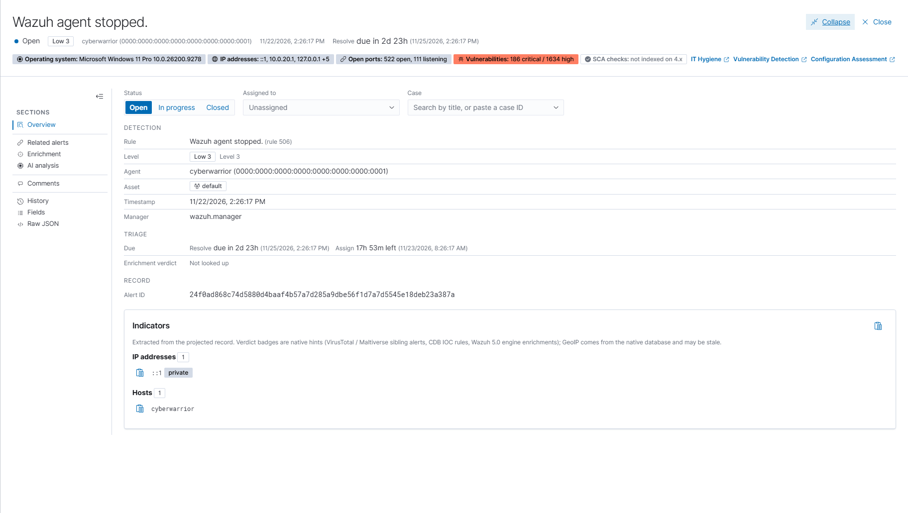

The flyout's sections sit on a left-hand rail, the same one the case flyout uses, grouped as Overview | Investigation | Work | Detail. The toggle at the bottom of the rail collapses it to an icon strip (tooltips carry the labels, count dots stay visible); the choice is remembered in the browser.

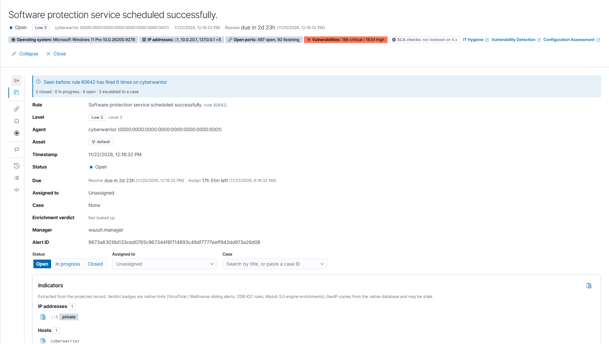

- **Overview** — a **"seen before"** precedent callout (how the same rule has been handled on the same host), then the controls you actually touch (**status** segmented control, **assignee**, **case**), then the record on a grouped metadata grid: *Detection* (rule, level or severity label, agent, asset, timestamp, manager), *Triage* (due, escalated, closure reason, enrichment verdict, native case on a 5.0 build) and *Record* (alert ID, last updated), followed by the indicators found on the alert. Status, assignee and case appear only once, as the controls. Expand to full-screen with the header button.
- **Related alerts** — alerts you've explicitly linked (the rail shows the linked count), plus a **Suggested** section that ranks alerts sharing a host, source IP, user, or rule within ±24h, each with a one-click **Link**.
- **Enrichment** — threat-intelligence lookups for the alert's indicators (IPs, hashes, domains, URLs) against the providers configured under Settings > Enrichment; stored verdicts are counted on the rail.
- **AI analysis** — optional, see [[AI Analysis]].
- **Comments** — a threaded discussion on the alert (the rail shows the thread count).
- **History** — the full audit trail.
- **Fields** — every field of the alert on a flat, searchable table.
- **Raw JSON** — the complete alert document.

---

## Cases

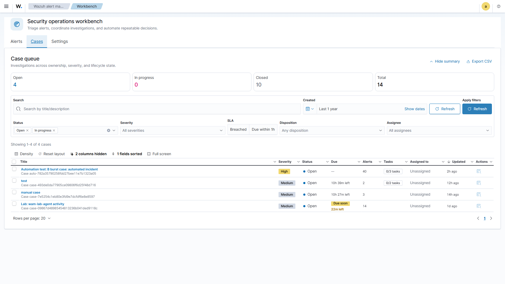

A **case** groups related alerts into a single investigation.

### Queue filters

Status, Severity, SLA, Disposition, Assignee, Created time, and title/description search are
combined with **AND**. Status, Severity, Disposition, and Assignee are multi-select controls.
Choosing `High + Critical` means either severity; choosing `admin + Unassigned`
means either ownership state. Summary cards use the same filters except Status,
so they continue to show the filtered Open/In-progress/Closed distribution.

### Case sections

The case flyout's sections sit on the same left-hand rail as the alert flyout,
grouped as Overview | evidence (Linked alerts, Assets, Timeline, Attack graph,
Indicators, AI analysis) | work (Tasks, Attachments, Comments) | History. The
toggle above the list collapses it to an icon strip, and the header keeps only
the title row, one metadata row (status, disposition, severity, assignee,
created / updated, SLA due, task count) and the Report / Expand / Close
actions.

- **Overview** — title, description, **severity** (Low / Medium / High /
  Critical), **status** (Open / In progress / Closed) and assignee as editable
  controls on one form grid, with the record metadata below as a grouped grid
  (Record: created, last updated, closed, disposition and closure reason;
  Progress: SLA due, tasks). The editable controls are the only place each of
  those values appears, so nothing is shown twice.
- **Default view** shows Open + In progress.
- **Linked alerts** — the case's evidence, paginated, with a search-and-select
  picker to add more.
- **Assets** — one collapsible row per distinct agent of the linked alerts,
  each showing that agent's OS, addresses, open ports, critical/high
  vulnerability count and SCA state once expanded, with deep links to IT
  Hygiene, Vulnerability Detection and (on Wazuh 4.x) Configuration Assessment.
  A row fetches only when it is first opened; the header line keeps the agent
  count and the aggregated counts. On Wazuh 4.x the SCA chip reads *not indexed
  on 4.x* and links out, because 4.x keeps SCA results in the manager database
  rather than the indexer.
- **Tasks** — a checklist on the case: add a task with an owner and a due date,
  tick it off (the plugin records who and when), reopen or remove it. The
  **Apply task list** control at the top of the section appends a reusable set
  from **Settings > Task lists**, with each due date counted from the moment it
  is applied; a task list is applied at most once per case. A case holds up to
  100 tasks, and the queue shows a "done/total tasks" chip.
- **Timeline** — alerts, comments, audit events and open task due dates merged
  into one list, grouped by day, with a **Load more** cursor.
- **Indicators** — every indicator across the case's alerts (IP, domain, URL,
  hash, user, process, host) with counts, first/last seen, any native verdicts
  and an on-demand **Lookup** against the configured enrichment sources.
- **Attachments** — links and small files (up to 2 MiB each, 20 per case, from
  an allowlist of media types). Files are stored in the plugin's own index and
  always download as an attachment, never rendered in the dashboard.
- **Comments** — threaded, like alerts.
- **Attack path** — a dependency-free entity graph of the case's alerts across **hosts / accounts / techniques**, with co-occurrence links and pan/zoom, plus a MITRE **kill-chain** table (tactic → techniques, first/last seen). Nodes are labelled by entity with an "N alerts" caption (one host in 102 alerts reads as *one host*, not 102).

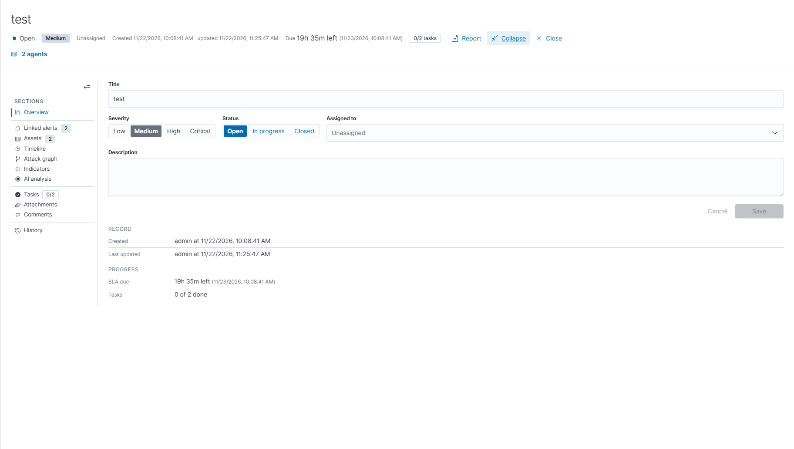

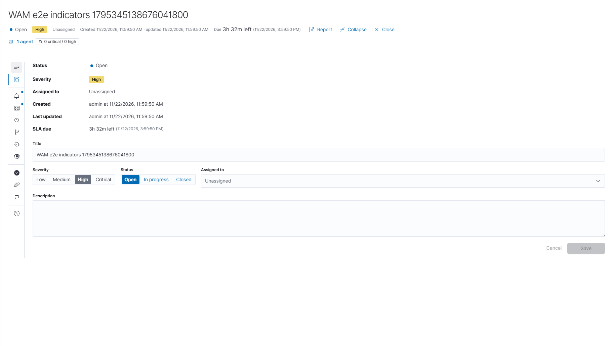

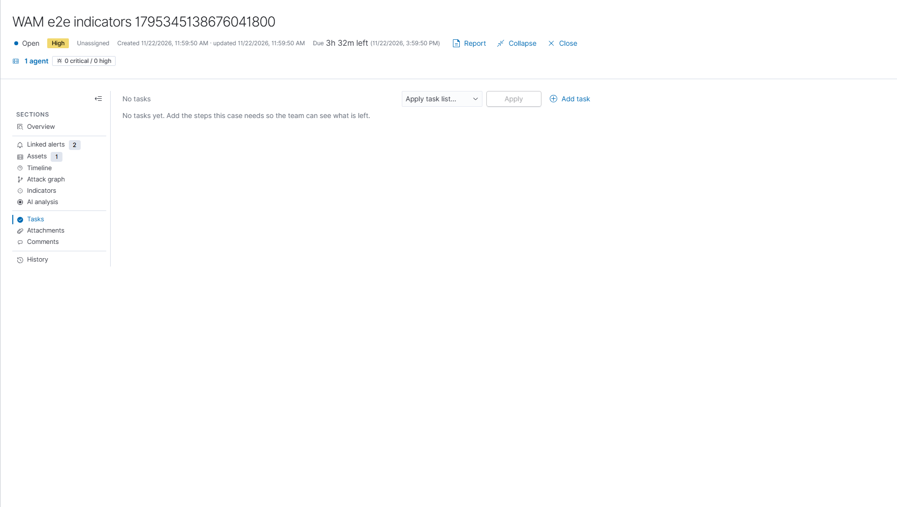

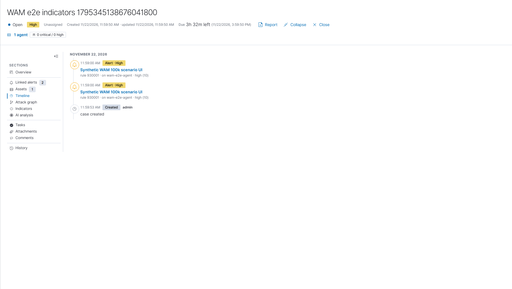

Cases can be created manually from selected alerts, or automatically by
[[Automation Rules]]. The create-case modal can apply a task list at the same
time.

### Case report

The **Report** button in the case flyout header downloads the whole case as
**Markdown** or a self-contained **HTML** page — summary, disposition and
closure reason, tasks, timeline, every linked alert, indicators, enrichment
verdicts, attachments, comments, the attack graph rendered as inline SVG, and
the MITRE table. **Print / Save as PDF** opens the HTML in a new tab with a
print stylesheet and calls the browser's Print dialog; pick *Save as PDF* as the
destination. No PDF library is bundled, so this is the only PDF path.

### Exports

Both queues have an **Export CSV** button that streams the currently filtered
list (up to 10,000 rows) as a file. A cell that looks like a spreadsheet
formula is prefixed with a single apostrophe and then quoted, so it opens as
text and never executes.

---

## Settings

Settings include:

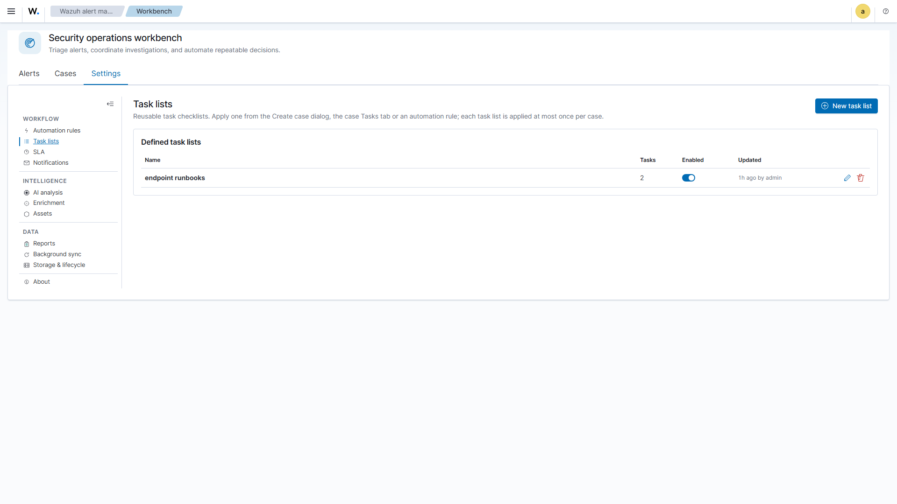

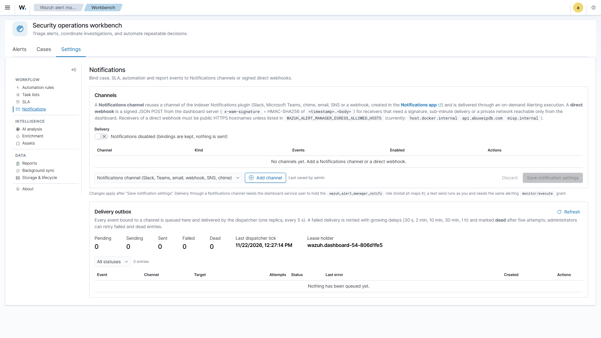

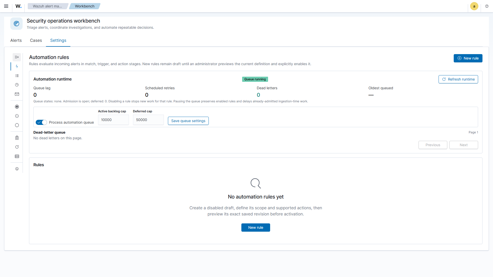

Settings sits beside a grouped navigation rail (**Workflow**, **Intelligence**,
**Data**, **About**) that collapses to an icon strip with the toggle above the
list; the choice is remembered per browser. Every page opens with a title, a
one-line description and a right-aligned Save / Reset row, and `?tab=` deep
links still work.

**Workflow**

- **Automation rules** — create, preview, revision, activate, pause, and diagnose
  ingestion-time rules. Queue and automation dead-letter controls are restricted
  to Wazuh administrators. See [[Automation Rules]].
- **Task lists** — reusable sets of case tasks (title, owner, due offset from
  the moment the list is applied). Create, edit, enable/disable and delete them
  here; apply one from the create-case modal, from a case's Tasks section, or
  automatically from an automation rule that opens a case. A task list is
  applied at most once per case. Writing requires a plugin administrator;
  everyone can read the list so the pickers work.
- **SLA** — the per-band assign and resolve targets and up to 20 escalation
  rules. Administrator-only to save; the summary is readable by everyone. See
  [[Reporting#sla-targets]].
- **Notifications** — bind delivery channels (an existing Wazuh Notifications
  channel, or a direct HMAC-signed webhook), choose which events each one
  receives, send a test, and watch the delivery outbox. See [[Notifications]].

**Intelligence**

- **AI analysis** — configure an optional LLM provider. API keys remain
  server-side and require the configured encryption key. See [[AI Analysis]].
- **Enrichment** — threat-intelligence sources (AbuseIPDB, MISP, generic HTTP,
  and on a Wazuh 5.0 build the built-in local CTI source). Each has a verdict
  cache TTL, a timeout, the indicator types it answers, and a **Test** button.
  API keys are encrypted at rest and never returned to the browser.
- **Assets** — asset criticality rules matched by agent name, glob, group or
  (4.x) label, each giving a criticality and tags. They are stamped on records
  as they are projected, so a rule affects new records only; a **Test match**
  control shows what a rule would match.

**Data**

- **Reports** — scheduled Markdown summaries (daily or weekly UTC slots, a
  range in days, and the channels to deliver to). Each schedule shows its next
  slot and its last run, with **Run now** and **Download**.
- **Background sync** — view the native-alert read pattern, sync watermark,
  overlap, interval, batch size, and sync-DLQ health. Changes apply to the plugin
  projection only; native Wazuh storage (`wazuh-alerts-*` on 4.x, `wazuh-findings-v5-*` on 5.0) remains read-only. On a Wazuh 5.0 dashboard the workbench says **Findings** wherever this guide says alerts (the tab, the queue, the details flyout, linked findings in a case). On Wazuh 5.0 the severity badge shows the finding's label (for example **High**) without a numeric level, because 5.0 rules carry labels rather than the 4.x 0–16 levels.
  The Background sync page also carries the **Discover and Reporting** card,
  which reports whether the plugin's index patterns and saved searches were
  provisioned (see [[Reporting#discover-and-opensearch-reporting]]).
- **Storage & lifecycle** — configure generation rollover and retention, inspect
  every plugin-owned alias family, and perform reviewed retire/restore/purge
  operations. Mutating controls require the effective Wazuh lifecycle role. See
  [[Lifecycle Retention and RBAC]] and [[Case Evidence and Case Lifecycle]].
- **About** — compare the browser and server build IDs. `Current` means both
  bundles came from the same installed release; a mismatch prompts a reload.

## Reporting

Reporting is a separate navigation child rather than a Workbench tab. All
figures are exact over the selected live, unarchived cohort; no document sample
is used. See [[Reporting]] for cohort semantics, SLA targets, archive effects,
backfill coverage, and analyst tabs.

### Export

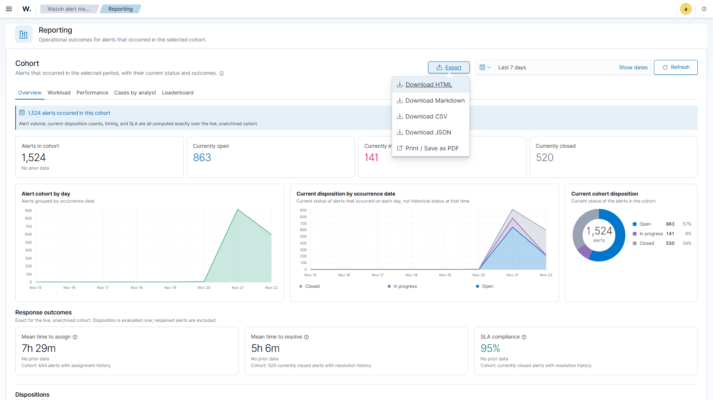

The **Export** menu in the Reporting header saves the selected window as a
file rendered by the server over exactly the cohort the page shows:

- **HTML** — a self-contained page (inline styles, no scripts) with the same
  sections as the page: alert volume by severity band and per day, status
  breakdown, dispositions, SLA summary and enforcement, top rules and agents,
  cases and analyst workload. The header carries the window and the exporting
  user, the footer the plugin version.
- **Markdown** — the same document as a scheduled summary.
- **CSV** — one file with each section as a titled block of rows (UTF-8 with
  BOM, so Excel opens it directly; cells that look like formulas are guarded).
- **JSON** — the raw metrics and extras with the window and `generated_at`.
- **Print / Save as PDF** — opens the HTML export in a new tab with a print
  stylesheet (each section on its own page, tables instead of charts) and
  calls the browser's Print dialog; pick *Save as PDF* as the destination. No
  PDF library is bundled, so this is the only PDF path.

Files are named `wam-report-<date>-<from>_<to>.<ext>`. The route
(`GET /api/wazuh_alert_manager/reports/export`) is read-only and runs as the
signed-in user, so an export never shows more than the page would.
